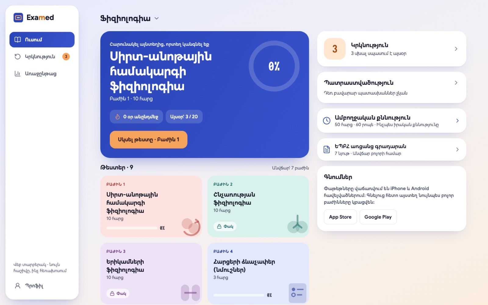
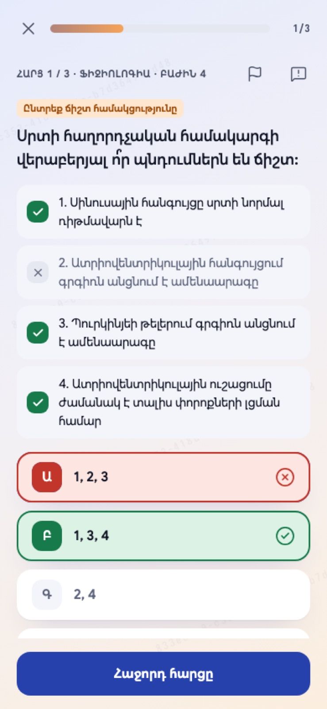
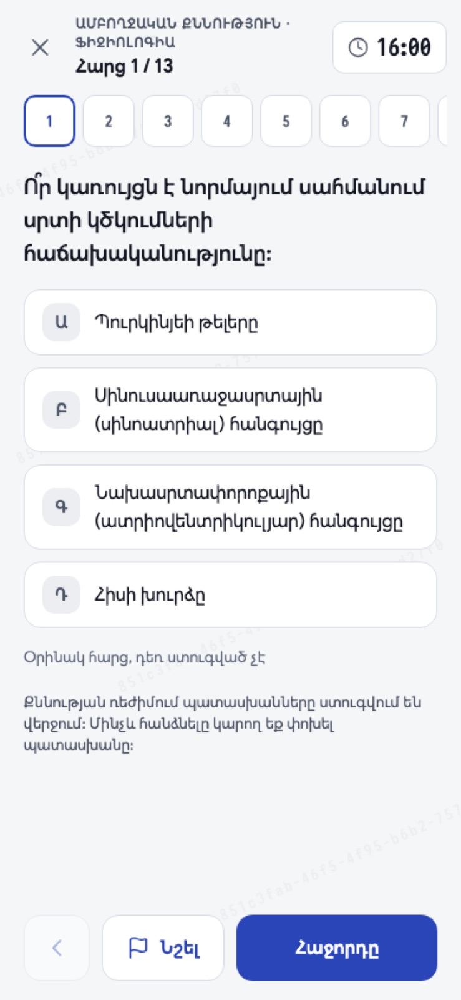
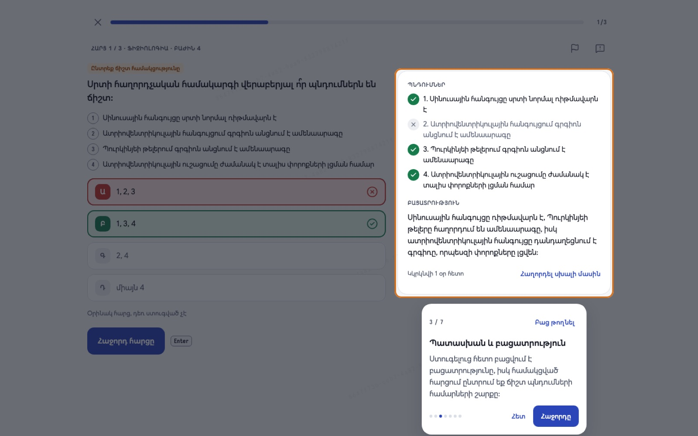
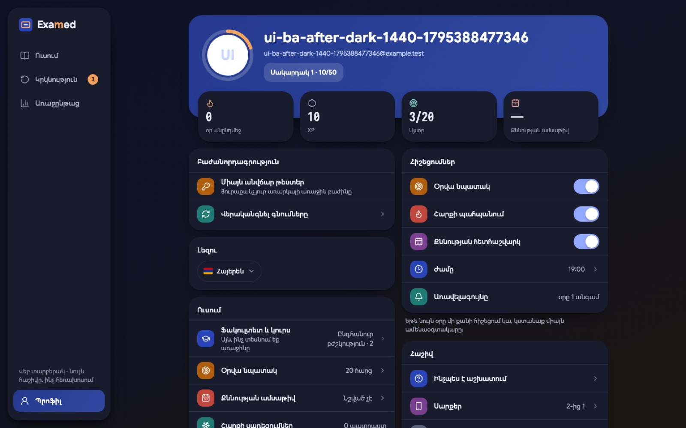

# Examed

An exam-prep app for medical students in Armenia that I designed and built on my own. One codebase
runs on the web, iPhone and Android.

**Try it:** https://examed.pages.dev

## The app

- Practice mode with an explanation after every answer, and a timed exam mode that shows nothing
  until you hand in
- A full mock exam: 50 questions in 60 minutes, drawn from the whole subject
- Wrong answers come back later in Review, on a spaced schedule
- Progress by topic, a daily goal and an exam date countdown
- A 7-step guided tour for first-time users
- Armenian, English and Russian, light and dark, phone and desktop layouts

| Question, answered | Exam mode | Guided tour |
|---|---|---|
|  |  |  |

All questions in the screenshots are sample content written for the demo.

## In numbers

- In closed testing since November 2026, not launched yet
- About 200 commits and 29,000 lines of TypeScript and SQL in the full project
- 67 backend tests and 33 browser tests, run on every change
- Lighthouse on a phone: performance 98, SEO 100 on the home page

## Architecture

- **One codebase, three platforms.** React Native with Expo and Expo Router, rendered on the web
  through react-native-web.
- **The database decides who sees what.** Paid questions and answers can't be read by the client
  directly. Postgres row-level security and SQL functions check the buyer's access on every read,
  so a modified client gets nothing extra.
- **Exam mode keeps the answers on the server.** Correct answers are not sent until the exam is
  handed in, so they can't be read from the network tab.
- **Limits against copying the content.** Two devices per account, a per-minute rate limit and a
  daily cap on paid questions.
- **Access is sold per subject or per course year.** Purchases arrive through a RevenueCat webhook
  that is safe to replay.
- **Layout bugs are caught by tests.** A Playwright suite opens every screen at phone, tablet and
  desktop widths and checks for overflow, overlapping elements, uneven cards, small tap targets and
  untranslated text.
- **Hosting:** Supabase (Postgres, auth, edge functions) and Cloudflare Pages.

## Code in this repo

The full app is in a private repository. These are files from it, unchanged:

| File | What it does |
|---|---|
| [sql/entitlements.sql](sql/entitlements.sql) | The access check every paid read goes through, the purchase webhook and the pricing query. |
| [sql/exam_hides_correctness.sql](sql/exam_hides_correctness.sql) | Exam mode: answers are stored without revealing which were right until hand-in. |
| [tests/attack.test.ts](tests/attack.test.ts) | 40 tests that try to read paid content the wrong way: without an account, with an expired purchase, through joins, from a third device, past the daily cap. |
| [tests/layout.spec.ts](tests/layout.spec.ts) | The browser layout checks described above. |
| [src/Tour.tsx](src/Tour.tsx) | The guided tour: a docked card that follows the user across screens, waits for the real action on each step, and resumes where it stopped. |

These files depend on the rest of the project, so they are here to read, not to run.

## Stack

TypeScript, React Native, Expo, Expo Router, react-native-web, Reanimated, Supabase (Postgres, RLS,
Edge Functions on Deno), RevenueCat, Playwright, Node test runner, Cloudflare Pages.
